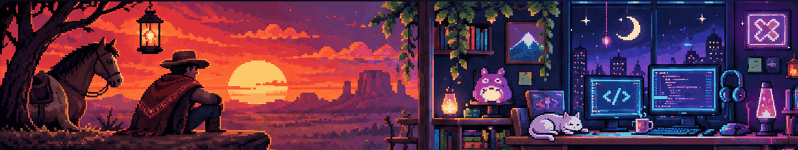
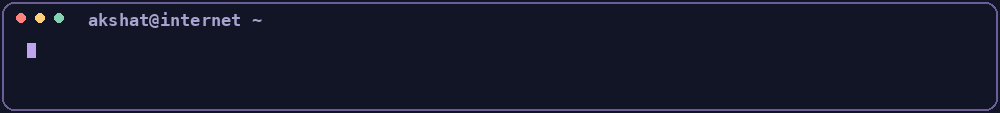
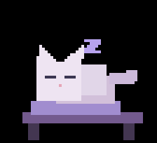
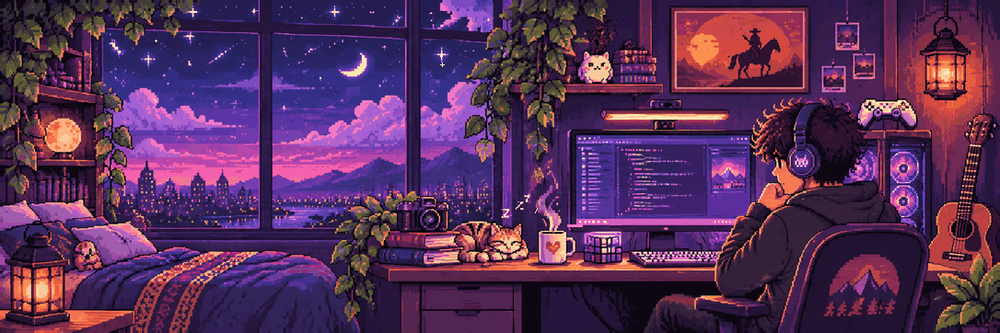
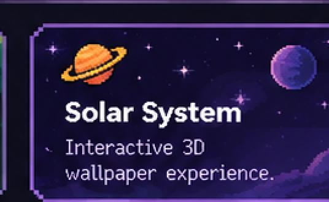
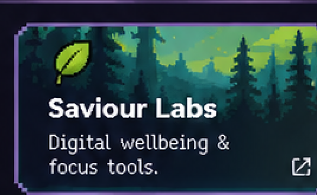
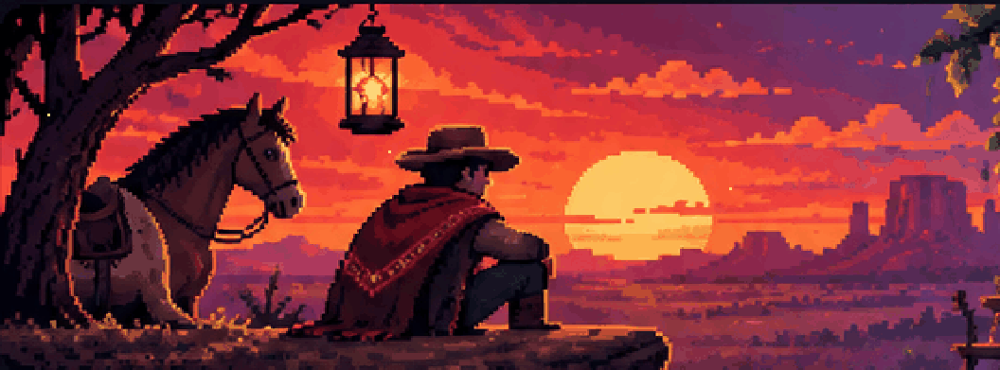
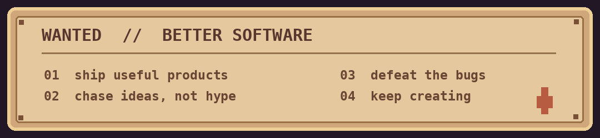
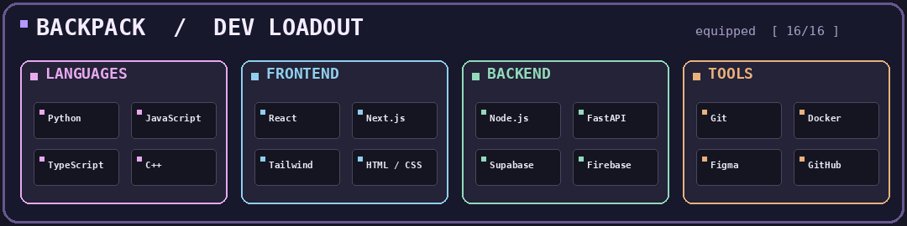
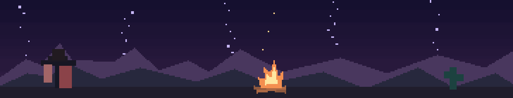

# hey, i'm akshat! 👋

**developer in progress · building useful things · occasionally lost in side quests**

`☁️ cozy mode` &nbsp; `🤠 outlaw mode` &nbsp; `🎧 music on` &nbsp; `🛠️ building in public-ish`

### 🪴 a little about me

<table>
<tr>
<td width="80%" valign="middle">

<ul>
<li>🎓 CSE undergrad at <b>NIET, Greater Noida</b>.</li>
<li>🧠 Into <b>software engineering, AI-native products & design</b>.</li>
<li>🚀 Turning random ideas into projects people might actually use.</li>
<li>🎸 Off-screen: <b>music, gaming & making art</b>.</li>
<li>🌱 Exploring <b>full-stack systems, AI and product architecture</b>.</li>
</ul>
<b>This little corner is equal parts code, curiosity, and side quests.</b>

</td>
<td width="20%" align="center" valign="middle">

my debugging partner

</td>
</tr>
</table>

### ☁️ cozy basecamp — where ideas start

🌙 one more feature • one more playlist • one more idea to build

 

### 🎮 Featured side quests

*Some projects I build, experiment with.*

<table>
<tr>
<td width="50%" align="center">

<a href="https://github.com/Axxshat/Solar-System">Solar System</a> · interactive space wallpaper
</td>
<td width="50%" align="center">

<a href="https://github.com/Axxshat/Saviour-Labs">Saviour Labs</a> · reclaim your focus
</td>
</tr>
</table>

 

### 🤠 the outlaw side quest

🌵 current mission: build something meaningful • solve real problems • don't let the bugs win

 

### 🎒 inventory / tech loadout

Not a skill rating — just things I've worked with or I'm learning.

 

### 🐍 the contribution trail

<picture>
  <source media="(prefers-color-scheme: dark)" srcset="https://raw.githubusercontent.com/Axxshat/Axxshat/output/github-contribution-grid-snake-dark.svg" />
  <source media="(prefers-color-scheme: light)" srcset="https://raw.githubusercontent.com/Axxshat/Axxshat/output/github-contribution-grid-snake.svg" />
  
</picture>

Live contribution animation. On first setup, run the included GitHub Action once so the generated SVGs exist.

 

### 💌 postcards from the internet

[**🌐 portfolio**](https://akshatchaurasia.vercel.app/) &nbsp; · &nbsp; [**💼 linkedin**](https://www.linkedin.com/in/akshat-chaurasia-a10943402/) &nbsp; · &nbsp; [**📸 instagram**](https://www.instagram.com/akshatchaurasia/) &nbsp; · &nbsp; [**🔗 all links**](https://linktr.ee/akshatchaurasia)

*technology should help people regain control, not lose it.*

thanks for stopping by. safe travels, internet wanderer. 🌙

